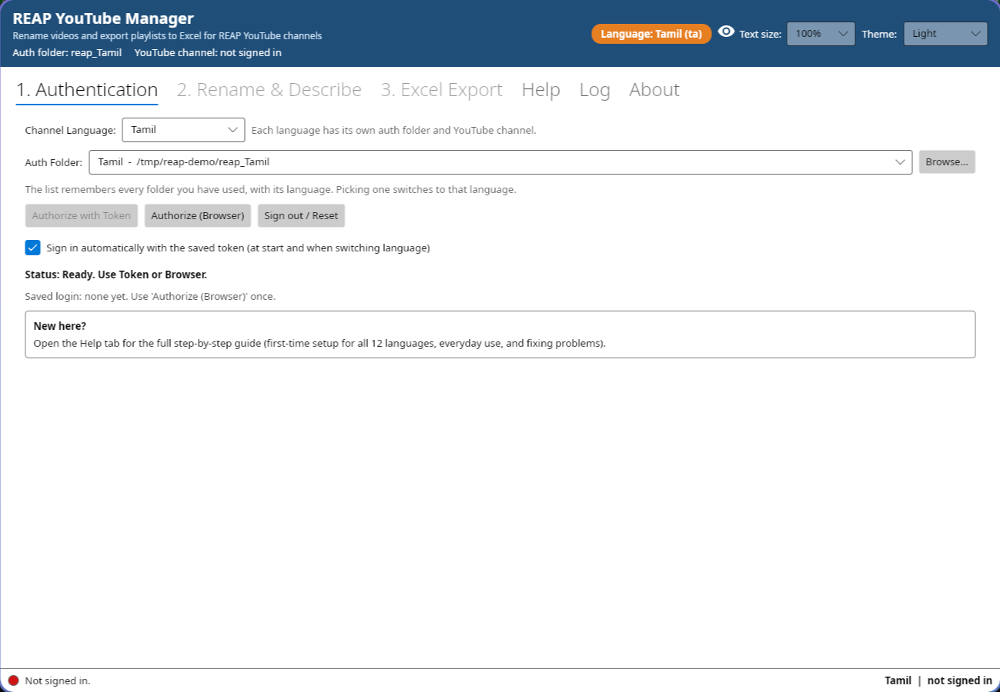
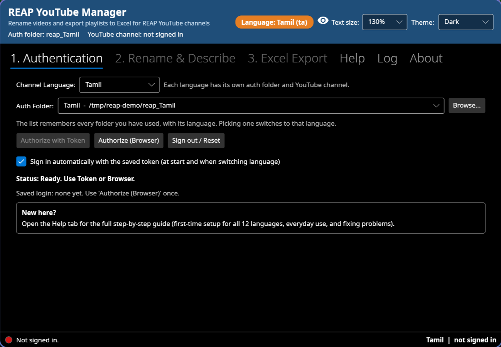
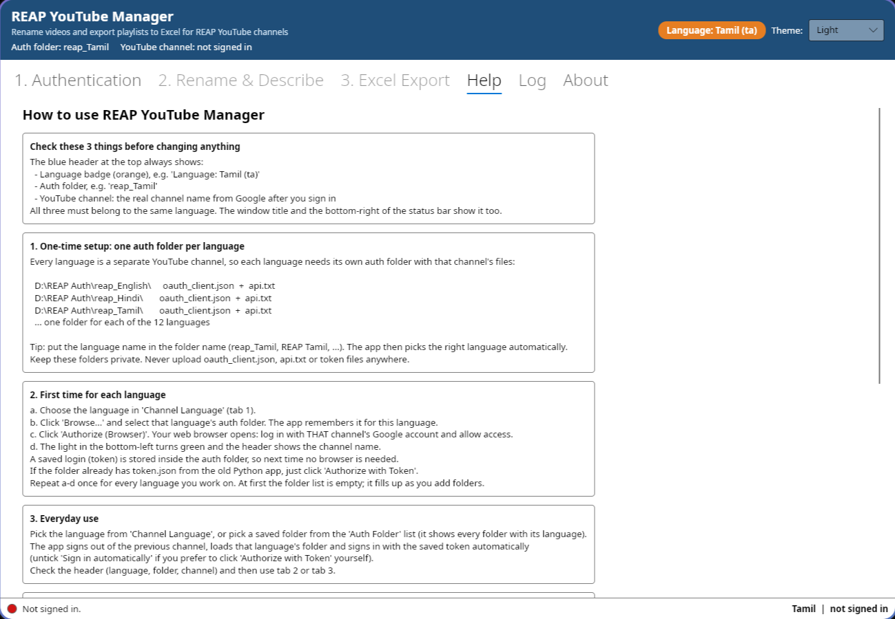

# REAP YouTube Manager

Desktop tool for the REAP YouTube channels (one channel per language):

- **Rename & Describe**: fix video titles to the `Chapter N - Topic` format and set descriptions, in bulk.
- **Excel Export**: export a playlist to an Excel sheet (course code, chapter, URL, title, description, order, language).

One app for all 12 languages: English, Hindi, Tamil, Telugu, Kannada, Malayalam, Bengali, Gujarati, Marathi,
Punjabi, Assamese, Odia. Light and dark mode. Open source.

**[Download the latest Windows exe](https://github.com/kannan983/reap--youtube-manager/releases/latest)**
(Windows 10/11, 64-bit, single file, nothing to install)

- [Screenshots](#screenshots)
- [User guide](#user-guide)
- [Developer guide](#developer-guide)
- [License](#license)

## Screenshots

**Sign-in tab** - the header always shows the language, the auth folder and the YouTube channel:



**Dark mode, text size 130%** (eye icon in the header):



**Built-in Help tab:**



---

# User guide

## Install (Windows 10/11, 64-bit)

1. Download `REAP_YouTube_Manager.exe` from the **Releases** page of this repo.
2. Put it anywhere (e.g. Desktop or `D:\REAP\`) and double-click it. Nothing to install.
3. If Windows says **"Windows protected your PC"**: click **More info** > **Run anyway**
   (the exe is not code-signed, this is normal).

## Always check these 3 things

The blue header at the top of the app always shows:

| Shows | Example |
|---|---|
| Language badge (orange) | `Language: Tamil (ta)` |
| Auth folder | `Auth folder: reap_Tamil` |
| YouTube channel (real name from Google, after sign-in) | `YouTube channel: REAP Tamil` |

**All three must be the same language before you rename anything or make an Excel sheet.**
The window title and the bottom-right of the status bar show the language and channel too.

## One-time setup: one auth folder per language

Every language is a separate YouTube channel, so each language needs **its own auth folder** containing
that channel's two files:

```
D:\REAP Auth\
├── reap_English\    oauth_client.json   api.txt
├── reap_Hindi\      oauth_client.json   api.txt
├── reap_Tamil\      oauth_client.json   api.txt
└── ...              (one folder for each of the 12 languages)
```

- Put the **language name in the folder name** (`reap_Tamil`, `REAP Tamil`, ...). The app then selects the
  right language automatically when you pick the folder.
- `api.txt` contains a line like `"API Key": "..."`.
- Keep these folders **private**. Never upload `oauth_client.json`, `api.txt` or token files anywhere.

## First time for each language

1. Tab **1. Authentication** > **Channel Language**: choose the language.
2. Click **Browse...** and select that language's auth folder. The app remembers it for this language.
3. Click **Authorize (Browser)**. Your browser opens: log in with **that channel's** Google account and allow access.
4. The light at the bottom-left turns **green** and the header shows the channel name.

A saved login (token) is stored inside the auth folder, so next time no browser is needed.
If the folder already has `token.json` from the old Python app, just click **Authorize with Token**.

Repeat for every language you work on. **At the start the folder list is empty**; it fills up as you add
folders with Browse.

## Everyday use

1. Open the app. It reopens the last language and signs in automatically with the saved token.
2. To change channel: pick another language in **Channel Language**, or pick a saved folder from the
   **Auth Folder** list (it shows every saved folder with its language). The app signs out of the previous
   channel, loads that language's folder and signs in.
   Untick **Sign in automatically** if you prefer to click **Authorize with Token** yourself.
3. Check the header (language, folder, channel), then use tab 2 or 3.

## 2. Rename & Describe

1. Select a playlist > **Load Videos**.
2. **Bold** titles are not in `Chapter N - Topic` format and will be renamed.
3. Check the **Corrected** and **Description** columns (double-click a cell to edit).
4. **Apply Changes** > confirm (the dialog names the channel). Only the bold rows are updated on YouTube.

## 3. Excel Export

1. Select a playlist > **Load Video Info** to preview.
2. **Generate Excel Sheet**. The file is saved to `<auth folder>\Excel sheet\` and the full path is shown.
3. The language code comes from the end of the playlist title (`NARQ30056_ta` -> `ta`). If it does not match
   the selected language you get a warning first.

## Draft Test (finish a Studio draft as Unlisted)

Tests whether the app can turn a YouTube Studio **Draft** into **Unlisted** without the 4 Studio steps:

1. Sign in to the channel (tab 1). In YouTube Studio > Content, copy the link of **one** draft video.
2. **Draft Test** tab: paste the link > **1. Read video** (1 unit, changes nothing).
3. **2. Make Unlisted** > confirm (50 units, changes only this video).
4. Refresh YouTube Studio > Content: does it show **Unlisted** or still **Draft**?
5. **Copy test report**, paste it in a message and add what Studio showed.

**List recent uploads** (about 3 units) shows the last 50 uploads with their privacy, to check whether drafts are visible to the API.

## Text size (eye icon) and theme

- **Text size** (eye icon in the header, next to the language badge): 100% to 200%. Makes everything bigger
  (text, buttons, tables, pop-ups) to reduce eye strain. Remembered for next time.
  Keyboard: **Ctrl +** bigger, **Ctrl -** smaller, **Ctrl 0** back to 100%.
- **Theme** (top-right): **System**, **Light** or **Dark**. Remembered for next time.

## Problems and fixes

| Message / problem | Fix |
|---|---|
| `oauth_client.json is missing` / `api.txt is missing` | Wrong folder selected, or the file is missing in it. |
| `The saved login expired or was revoked` | Click **Authorize (Browser)** and log in again. |
| Login expires about every 7 days | The Google Cloud OAuth app is in "Testing" mode. In Google Cloud Console: **APIs & Services > OAuth consent screen > Publish app > In production**. |
| Header shows the wrong channel name | You logged in with the wrong Google account. **Sign out / Reset**, delete `Google.Apis.Auth.OAuth2.Responses.TokenResponse-user` (and `token.json`) in that auth folder, then **Authorize (Browser)** again. |
| "Windows protected your PC" | **More info** > **Run anyway**. |

## Reporting a problem (logs)

- **Log** tab: live log. Tick **Show debug details**, repeat the problem, click **Copy all** and send it.
- Log files: `%LOCALAPPDATA%\REAP_YouTube_Manager\logs`
  (e.g. `C:\Users\<you>\AppData\Local\REAP_YouTube_Manager\logs`). The full path is shown in the **Log** and
  **About** tabs with **Copy path** and **Open logs folder**. Files older than 30 days are deleted automatically.
- Logs never contain passwords or API keys.

---

# Developer guide

## Stack

- C# / .NET 10, [Avalonia 11](https://avaloniaui.net/) (cross-platform UI, Fluent theme, light/dark)
- `Google.Apis.YouTube.v3` (OAuth + YouTube Data API v3), `ClosedXML` (Excel)
- Runs on Windows and Linux; ships as one self-contained Windows exe.

## Layout

```
ReapManager/
├── ReapManager.csproj   project, package versions, single-file publish settings
├── Program.cs           entry point, theme, global error logging, --selftest
├── Core.cs              pure logic: title correction, sort order, Excel rows, file names, languages + self-test
├── Infra.cs             AppInfo (name, version, repo URL), Log (file + live), Settings (settings.json)
├── MainWindow.cs        the UI (code-only, no XAML) and the YouTube/Excel actions
└── HelpText.cs          text of the in-app Help tab (keep in sync with the User guide above)
REAP <Language>/gen3_youtube_gem.py   original Python version, kept for reference
```

## Build and run

Install the .NET 10 SDK (Fedora: `sudo dnf install dotnet-sdk-10.0`, Windows: `winget install Microsoft.DotNet.SDK.10`).

```
cd ReapManager
dotnet run                                              # run the app
dotnet run -- --selftest                                # logic self-test (prints ok/FAIL, exit code 0/1)
dotnet publish -c Release -r win-x64 -o ../publish      # single Windows exe -> publish/REAP_YouTube_Manager.exe
```

The Windows exe can be built on Linux (the command above); no Windows machine needed.

## Release

GitHub Actions (`.github/workflows/build.yml`) builds **only Windows x64** on a Windows runner: self-test, then
`dotnet publish -r win-x64`. Every push to `windows` uploads the exe as a build artifact.

1. Bump `<Version>` in `ReapManager.csproj` and update `.github/release-notes.md`.
2. Commit, then tag and push: `git tag v2.0.1 && git push origin v2.0.1`
3. The workflow creates the GitHub Release with `REAP_YouTube_Manager.exe` and its SHA256 attached.

## Where things are stored

| What | Where |
|---|---|
| Settings (language, theme, auth folder per language, auto sign-in) | `%LOCALAPPDATA%\REAP_YouTube_Manager\settings.json` (Linux: `~/.local/share/...`) |
| Logs | `%LOCALAPPDATA%\REAP_YouTube_Manager\logs\yyyy-MM-dd_HH-mm-ss.log` |
| Saved Google login | inside each auth folder: `Google.Apis.Auth.OAuth2.Responses.TokenResponse-user` (old app: `token.json`) |
| Excel output | `<auth folder>\Excel sheet\<playlist description>_<course code>.xlsx` |

## Notes

- **Languages**: the list and language codes are in `Core.Languages`. Folder-name detection is `Core.DetectLanguage`
  (also accepts `Assamees` and `Oriya`).
- **API calls**: playlists, video updates and the channel name use OAuth; listing a playlist's videos uses the API
  key from `api.txt` (same as the Python version).
- **Logic changes**: change `Core.cs` and add a check to `Core.SelfTest()`.
- **Never commit** auth folders, `oauth_client.json`, `api.txt`, tokens, `bin/`, `obj/`, `publish/` (see `.gitignore`).

---

# License

[MIT](LICENSE) - free to use, copy, modify and share. Copyright (c) 2026 kannan983.
